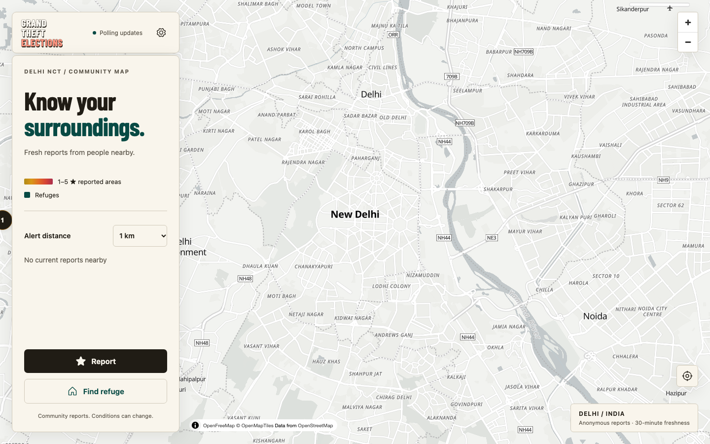
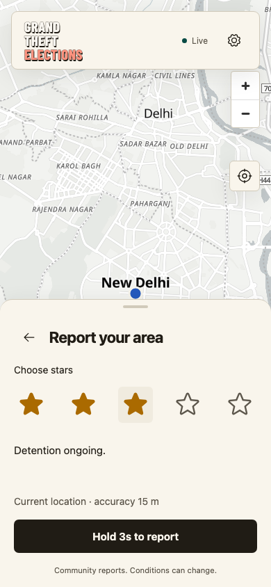

# Grand Theft Elections

Know your surroundings. Share what you see.

**[Open the Delhi community map →](https://grandtheftelections.in)**

Grand Theft Elections is a community map for Delhi: see recent reports from people nearby, share a quick star rating for your area, and find walking directions to host-confirmed refuges. It works on desktop and mobile, with a light interface designed for daytime readability. You don’t need an account to use the map.

*The desktop map, captured from the live app. An area without reports is not necessarily safe.*

## What you can do

- **Report your area:** choose 1–5 stars, read the short description, then hold to submit (3 seconds by default). Reports are grouped into 250 m areas rather than publishing your exact reporting location.
- **See nearby activity:** coloured gradient hotspots show grouped community reports. Reports expire, so old activity does not stay on the map indefinitely.
- **Choose your alert distance:** the default range is 500 m–3 km in 500 m steps. Alerts work while the map is open in the foreground; optional sound can be stopped with **Ack**.
- **Find a refuge:** preview walking directions to an eligible, host-confirmed location when one is available. Routes are calculated in your browser using OpenStreetMap data.

### Reporting on mobile

*The report picker with three stars selected. This screenshot uses a simulated Delhi location; no report was submitted.*

The star descriptions keep reporting quick and consistent:

| Stars | Meaning |
| --- | --- |
| 1 | Checkposts with fewer than 5 personnel |
| 2 | Active personnel |
| 3 | Detention ongoing |
| 4 | Manhandling and higher personnel count |
| 5 | Full-blown violence |

Allow location access when reporting or finding a route. Phone browsers require a trusted HTTPS connection for location access. There are no background notifications or a public map of individual participants.

## Behind the map

The private operator console supports incident moderation, refuge management, team access and an audit trail. Owners can adjust report freshness, alerts and other [runtime settings](docs/operations/runtime-settings.md) without redeploying. Operators access `/admin` directly and sign in with an email as their username and a password.

The application combines a Go API, PostgreSQL/PostGIS and Redis with a React/MapLibre frontend. Live zone updates use server-sent events with polling fallback; proximity checks and walking-route computation stay in the browser. The target is 100,000 concurrent users, but that capacity has **not been validated** with production load tests.

## Run it or contribute

Contributions are welcome: bug fixes, accessibility improvements, documentation and carefully scoped features all help. Start with [CONTRIBUTOR.md](CONTRIBUTOR.md) for local setup, tests and pull-request guidance. The local map works without importing a walking graph; route previews require that additional setup.

For more context:

- [Product decisions](PRODUCT.md) and [design direction](DESIGN.md)
- [Architecture and behaviour](docs/architecture.md)
- [Operations runbook](docs/operations/runbook.md) and [GCP deployment](docs/operations/gcp.md)
- [Verification scope and measured results](docs/operations/verification.md)

## Project and data notices

This is an independent parody project, unaffiliated with or endorsed by Rockstar Games or the Grand Theft Auto franchise. Its branding and interface assets are original; no game artwork or media is bundled.

Community reports, host confirmations and mapped routes do not guarantee safety. Conditions can change, and a lack of reports does not verify an area or journey.

The code is [MIT licensed](LICENSE). Map and other third-party data have their own licences and attribution requirements; see [third-party notices](THIRD_PARTY_NOTICES.md). Screenshot basemaps use OpenFreeMap and © OpenStreetMap contributors.
