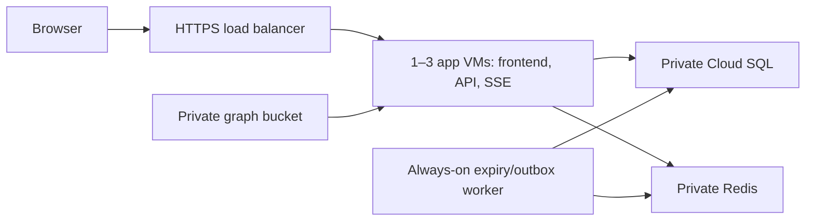

# GCP deployment

The initial deployment uses the Delhi region (`asia-south2`). One private
`n2-standard-2` public application VM has 2 vCPU and 8 GB RAM. A regional managed
instance group is configured for 1–3 replicas, with CPU utilization target 65%
and a 300-second initialization period. Its policy stays disabled until the
application is healthy and the production HTTPS origin is configured.

The same Docker image serves the frontend, API and SSE with `APP_ROLE=gateway`.
Despite that role's name, the current HTTP handler includes the public and admin
API endpoints; this role excludes the expiry/outbox worker. A separate private
`e2-highcpu-2` worker VM has 2 vCPU and 2 GB RAM and uses `APP_ROLE=worker`.
Worker autohealing/failover is not configured in this initial deployment.

Cloud SQL PostgreSQL 17 uses 1 vCPU, 3.75 GB RAM, regional high availability,
20 GB SSD with storage auto-growth, daily backups, seven-backup retention,
point-in-time recovery, deletion protection, and private IP only. This is the
supported small dedicated-memory allocation, not the earlier Fly 2 GB plan.
Memorystore Redis 7.2 uses Standard HA with 1 GB capacity, private service access
and AUTH. Redis traffic is private but not TLS-enabled in this initial setup.
The Cloud SQL Auth Proxy encrypts database connections using VM identity.



All VMs lack external IP addresses. SSH is restricted to IAP and OS Login.
Cloud NAT provides outbound access for package installation and image downloads. Nginx
accepts backend traffic from Google's load-balancer ranges, extracts the client
IP from the trusted forwarding chain, and replaces `X-Real-IP` before proxying
to Go on localhost. The app trusts only that localhost proxy. Proxy access logs
are disabled to avoid recording session information or subscription URLs.

## Provision foundation

Authenticate with `gcloud auth login`. Explicit project flags keep the active
CLI configuration unchanged. Enable these APIs in the intended project:

```sh
gcloud services enable compute.googleapis.com sqladmin.googleapis.com redis.googleapis.com servicenetworking.googleapis.com artifactregistry.googleapis.com secretmanager.googleapis.com iam.googleapis.com cloudresourcemanager.googleapis.com cloudbuild.googleapis.com iap.googleapis.com logging.googleapis.com monitoring.googleapis.com --project=PROJECT_ID
python3 deploy/gcp/provision.py --project=PROJECT_ID
```

The provisioning helper reuses resources by name; it does not reconcile drift
or replace an existing deployment. It creates a custom VPC and application
subnet, private service allocation/peering, NAT, restricted firewall rules,
Artifact Registry, private routing/build/backup buckets, scoped runtime/build
identities, three Secret Manager containers, asynchronous SQL/Redis instances,
and a reserved global load-balancer address. Native Cloud SQL backups are
independent of the bucket; the backup bucket is available for private exports.

Wait for SQL `RUNNABLE` and Redis `READY`, then run:

```sh
python3 deploy/gcp/database.py --project=PROJECT_ID
```

This creates database/user `gte` and stores a generated password in the database
URL secret. Passwords never appear in command arguments or script output. SQL
user password updates use authenticated API request bodies. Redis credentials
are also stored in Secret Manager. The VM receives only resource-scoped secret
access, registry/graph read access, SQL connector access, and telemetry writes;
there are no downloaded service-account keys.

## Build and prepare compute

Use the repository root as the build context. `.gcloudignore` excludes local
secrets, graphs, dependencies, screenshots and worktrees from the upload.

```sh
gcloud builds submit . --project=PROJECT_ID --region=asia-south2 --tag=asia-south2-docker.pkg.dev/PROJECT_ID/gte/app:RELEASE --service-account=projects/PROJECT_ID/serviceAccounts/gte-build@PROJECT_ID.iam.gserviceaccount.com --gcs-source-staging-dir=gs://PROJECT_ID-gte-builds/source --gcs-log-dir=gs://PROJECT_ID-gte-builds/logs
python3 deploy/gcp/compute.py --project=PROJECT_ID --image=asia-south2-docker.pkg.dev/PROJECT_ID/gte/app@sha256:IMAGE_DIGEST
```

Compute is pinned to the image digest. Existing managed groups using a different
template require an explicit rolling release, and existing worker VMs are not
automatically upgraded. Do not run mixed incompatible reporting-grid versions.

Upload graph version directories before uploading `manifest.json`. Keep versions
referenced by deployed manifests. Application VMs download a local read-only
copy at startup. No graph or genuine reports/refuges are seeded in PostgreSQL.
The private graph bucket is not a public CDN in this initial deployment.

## Finish production configuration

Reserve an application domain. Admin sign-in uses an approved email and password,
with no OAuth provider or client configuration. Copy
`deploy/gcp/app-config.example.json` into an ignored `artifacts/gcp/` directory,
set file permissions to 600, and fill every field. Use the reserved `gte-web`
address for `LB_IP`. Store the completed file directly in Secret Manager:

```sh
gcloud secrets versions add gte-app-config --data-file=artifacts/gcp/app-config.json --project=PROJECT_ID
```

Do not commit the completed file or print credentials. Bootstrap retries
missing configuration every 60 seconds. It starts the SQL proxy, app and nginx
only after valid configuration and (on web VMs) a graph manifest are available.
Changing a secret does not restart already-running containers: restart the
launch service or perform a coordinated rollout after updating configuration.

Provision the initial owner's password once the app is running. Connect to a web
VM through IAP, then use the hidden interactive prompt (replace the email):

```sh
sudo docker exec -it gte-app /app/gte set-password --email owner@your-domain.example
```

The username is `OWNER_EMAIL`. Add subsequent accounts in owner Team access and
run the same command for each approved email. Resetting a password revokes all
sessions for that account. Passwords never belong in app configuration or command
arguments. There is no public registration or email reset service.

Create the Google-managed certificate, TLS 1.2+ HTTPS frontend, and permanent
HTTP-to-HTTPS redirect using the reserved address and `gte-web` URL map:

```sh
python3 deploy/gcp/https.py --project=PROJECT_ID --domain=grandtheftelections.in
```

Set the apex (`@`) DNS A record to the reserved address, removing conflicting
parking A records and any AAAA record that points elsewhere. Keep MX and TXT
records intact. Wait for certificate activation; this script does not change
registrar DNS. The backend timeout is
3600 seconds because SSE is a long-running response, not a series of short
requests. Clients must tolerate reconnects during timeout, maintenance and
scale-down. Connection draining is 60 seconds; it is not unlimited stream
preservation. The worker must remain running even when no visitors are online.

Verify the HTTPS frontend, `/api/v1/health`, password login, authenticated admin API,
report submission, SSE updates, polling fallback and walking graph retrieval
before activating the prepared autoscaling policy:

```sh
gcloud compute instance-groups managed set-autoscaling gte-web --region=asia-south2 --mode=on --min-num-replicas=1 --max-num-replicas=3 --target-cpu-utilization=0.65 --cool-down-period=300 --project=PROJECT_ID
```

Do not enable destructive VM autohealing based only on dependency health: a
worker/database outage must not trigger a fleet-wide recreate loop.

## Measurements and limits

The Ops Agent collects host memory/CPU and bounded Docker logs. CPU-based
autoscaling is the initial mechanism; active SSE count, update latency, outbox
age and expiry lease are not yet exported as application Monitoring metrics.
There is no notification channel configured by default. Add verified operator
notification channels and alert policies before a public launch.

Use the agreed provisional targets: CPU 65% for three minutes, memory 70% for
three minutes, write p95 <500 ms, connected-client visibility p95 <2 s, errors
<1%, expiry lease warning at 2 s, sustained outbox age warning at 2 s. Database
pools are capped at 10/public VM and 5/worker; monitor contention and query waits.
The current setup does not enforce the previously suggested 1000/1500 stream
limits or scale from connection counts. Set those from measured per-VM capacity
when application metrics and admission limits are implemented.

Subscription query separators are left unescaped while other characters remain
encoded. This keeps the maximum supported 4096-cell request under 48 KiB,
leaving space for headers within GCP's fixed load-balancer limit. Nginx permits
64 KiB request lines; it cannot expand the upstream GCP limit.

Test 500 → 1000 → 2000 → 5000 concurrent clients with writes, expiry and reconnect
bursts, then one-hour sustained workloads. Neither this provisioning nor earlier
laptop measurements establish 100000-user capacity. See
[verification scope](verification.md) and [runbook](runbook.md).

## Continuous deployment from GitHub

`cloudbuild.yaml` tests, builds and publishes the application image. The
`gte-master-deploy` Cloud Build trigger runs on pushes to **`master` only** and
enables production deployment. Pull requests keep the GitHub Actions checks;
they receive no deployment identity or production credentials.

Configure the trigger after foundation provisioning:

```sh
python3 deploy/gcp/cicd.py --project=PROJECT_ID --region=asia-south2 --origin=https://grandtheftelections.in
```

The helper configures a second-generation `gte-github` connection and links
`xdadwal/gte-vi`. Its first run may print a browser authorization link: install
Google's Cloud Build GitHub App with access to this repository, then rerun the
helper. This authorization is separate from application admin sign-in. The
connection credential stays in Secret Manager under the Cloud Build service
agent; the helper never exports a personal `gh` credential or downloads a key.
Temporary Secret Manager administration for the installation handshake is
removed once the connection reaches `COMPLETE`.

The existing `gte-build` identity has registry/build-bucket access, log writes,
a custom Compute role for template creation, managed-group updates and worker
metadata, IAP/OS Login access, and permission to attach the runtime identity.
It has no direct application-secret access grant. Its privileged worker SSH
access means only reviewed, trusted code should reach `master`. The provisioner
does not change GitHub branch protections.

### Pipeline behaviour

1. A disposable Docker network runs PostGIS and Redis. Go race tests/vet,
   frontend tests/build and the normal Playwright suites run against that stack.
   Browser fixtures never connect to production. Python deployment tests also
   run before building the release image.
2. The image is tagged with commit SHA and build ID, pushed to Artifact Registry,
   and resolved to an immutable digest. The deployment helper rejects mutable
   tags and images outside the project's application registry.
3. A Cloud Storage object created with `ifGenerationMatch=0` serializes releases.
   Builds wait up to 15 minutes for this lock; an obsolete commit is skipped if
   it is no longer GitHub `master` HEAD after acquiring the lock.
4. A new immutable instance template is cloned from the current web template
   with the new image/startup script. The worker's image/launcher is updated
   through private IAP SSH and its health is checked before updating web VMs.
   The single worker restart can briefly interrupt report freshness and streams.
5. The regional web group rolls out with zero allowed unavailable instances and
   one surge slot per configured zone. An application health check gates rollout;
   failed health checks **do not** enable destructive autohealing. Existing SSE
   connections can reconnect during replacement/draining.
6. Success requires every web VM to be running, on the new template and healthy,
   with the group stable and its version target reached. Read-only public checks
   verify HTTPS/frontend, health, polling snapshot, initial SSE snapshot and a
   versioned graph tile. No admin password, report or refuge fixture is used.

Release records live in `gs://PROJECT_ID-gte-builds/deploy/releases/BUILD_ID.json`.
They include commit/digest, previous worker image and previous web template.
`deploy/current.json` is updated only after verification. Old images/templates
are retained. The rollout deadline is 25 minutes, plus lock wait; Cloud Build's
whole-pipeline deadline is one hour. If checks or image publication fail, no
production deployment starts. Default manual builds use `_DEPLOY=false`:

```sh
gcloud builds submit . --project=PROJECT_ID --region=asia-south2 --config=cloudbuild.yaml --substitutions=COMMIT_SHA=FULL_COMMIT_SHA,_DEPLOY=false --gcs-source-staging-dir=gs://PROJECT_ID-gte-builds/source
```

Keep schema/protocol changes backward compatible across the worker and old/new
web instances. This pipeline does not infer migration compatibility or reverse
database changes. Incompatible changes require disabling the trigger and a
coordinated maintenance deployment described in the runbook.

### Failed or cancelled deployments

A failure after deployment starts deliberately retains `deploy/lock.json`.
Cancellation/timeouts can leave a Compute rollout running; the next build must
not assume that an expired build means resources stopped changing. Inspect the
owning build, release record, worker container, group version and backend health.
Stop or finish the rollout before allowing another release. Never clear a lock
owned by an active build.

For a compatible-image rollback, restore the recorded worker image and launcher,
restart/check the worker, then roll the group back to `previousTemplate` using
zero unavailable instances. Check HTTPS, SSE, polling and routing again. A
rollback of application images does not roll back the database; do not use it
across an incompatible migration.

After the owning build and any Compute operation are terminal and the fleet is
in a reviewed state, inspect the lock generation and remove **that generation**:

```sh
gcloud storage cat gs://PROJECT_ID-gte-builds/deploy/lock.json
gcloud storage objects describe gs://PROJECT_ID-gte-builds/deploy/lock.json --format='value(generation)'
# Replace LOCK_GENERATION with the generation you inspected.
gcloud storage rm gs://PROJECT_ID-gte-builds/deploy/lock.json --if-generation-match=LOCK_GENERATION
```

Rerun the latest master build after recovery. Merely rerunning the failed build
without resolving its lock is not a recovery procedure.
